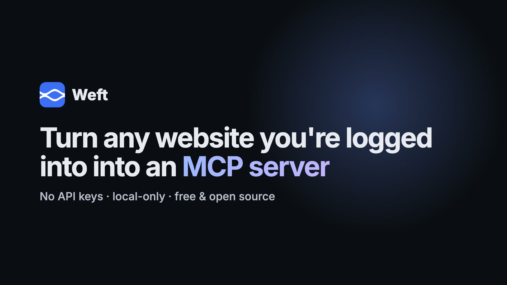

<div align="center">

# Weft

**Turn any website you're logged into into a local MCP server your AI tools can query.**

No API keys. No OAuth apps. No cloud. Weft rides the session you already have in your browser,
maps the site's API from real traffic, and serves it to Claude Code, Claude Desktop, Codex, and
Cursor over the Model Context Protocol — all on `localhost`.

[](https://github.com/vilvaathibanpb/weft/actions/workflows/ci.yml)
[](LICENSE)


**[Website](https://vilvaathibanpb.github.io/weft/) · [Docs](https://vilvaathibanpb.github.io/weft/docs.html) · [Download](https://github.com/vilvaathibanpb/weft/releases/latest) · [2-min demo](https://youtu.be/nOrxH0BQnvU)**

[](https://youtu.be/nOrxH0BQnvU)

</div>

---

## Why

Half the tools you use every day have no API, a bad one, or one locked behind an enterprise plan.
But they *do* have a web app you're already logged into — and that web app talks to a perfectly
good JSON API under the hood. Weft captures that API from your own browser session and hands it to
your AI assistant as an MCP server. Ask Claude Code "what are my open issues?" and it calls the
same endpoint the website does, with your own session, on your machine.

## How it works

```
  ┌───────────────┐   ws 127.0.0.1:8787   ┌──────────────────────────┐
  │ Chrome          │ ───── capture ─────▶ │  Weft desktop app          │
  │ extension       │ ◀──── replay ─────── │  (Rust core + Tauri UI)    │
  │ "Convert to MCP"│                      │  • endpoint model           │
  └───────────────┘                      │  • OpenAPI synthesis        │
                                           │  • MCP server (8788)        │
                                           └────────────┬──────────────┘
                                                         │ stdio (via mcp-shim)
                                   ┌─────────────────────┼─────────────────────┐
                                   ▼                     ▼                     ▼
                              Claude Code           Claude Desktop         Codex / Cursor
```

1. You click **Convert this site to MCP** in the extension.
2. The extension snapshots your session (cookie **names** and storage **keys** — never values) and
   streams the site's live API traffic to the local app.
3. The app folds that traffic into a deduped, path-templated endpoint model.
4. Your AI client reaches the app's MCP server through a tiny stdio shim and can list endpoints,
   read a synthesized OpenAPI spec, and **replay** calls using your live session.

Everything runs on `127.0.0.1`. Nothing is sent to us or anyone else. There is no account and no
telemetry. See [SECURITY.md](SECURITY.md) for the threat model and exactly what touches your
credentials (short version: values never leave the browser, and writes require explicit consent).

## Install

**Two steps** — the app, then the extension.

### 1. The app

Download the installer for your OS from the [latest release](https://github.com/vilvaathibanpb/weft/releases/latest):

- **macOS** — `Weft_0.1.0_universal.dmg` (Apple Silicon + Intel, signed & notarized)
- **Windows** — `Weft_0.1.0_x64-setup.exe` or `.msi`
- **Linux** — `.AppImage`, `.deb` or `.rpm`

You'll also need **Node.js 20+** (your AI client starts Weft's tiny stdio connector with it).

<details>
<summary>Run from source instead</summary>

```bash
git clone https://github.com/vilvaathibanpb/weft
cd weft
npm install
cd apps/desktop && npm run tauri dev
```

Building from source needs [Rust](https://rustup.rs) and the
[Tauri prerequisites](https://tauri.app/start/prerequisites/) for your OS.
</details>

### 2. The extension

The Chrome Web Store listing is in review. Until then: download `weft-extension-0.1.0.zip` from
the [latest release](https://github.com/vilvaathibanpb/weft/releases/latest), unzip it, open
`chrome://extensions` → enable **Developer mode** → **Load unpacked** → select the folder.

### 3. Connect your AI client

In the app, click **Open in client** on a ready site (or use the **Clients** page) and pick
Claude Code, Claude Desktop, Codex or Cursor. Weft adds a single `weft` entry to that client's MCP
config — nothing else is touched. Restart the client.

From a clone you can do the same from the command line:

```bash
node scripts/weft-install.mjs claude-code     # or: claude-desktop | codex | cursor | all
```

## Use it

Open a site you're logged into, click **Convert this site to MCP**, browse it for a few seconds so
Weft sees the API, then ask your assistant. The MCP server exposes:

| Tool | What it does |
|------|--------------|
| `list_sites` | Origins you've captured, with status and endpoint count |
| `list_endpoints` | Methods + path templates + query params + status codes for a site |
| `get_endpoint` | Full detail for one endpoint |
| `search_endpoints` | Find endpoints by method/path |
| `get_openapi` | A synthesized OpenAPI 3.1 spec (observed-only, no invented schemas) |
| `get_auth_context` | Cookie **names** / storage **keys** (never values) |
| `call_endpoint` | Replay a request using your live session (writes need `confirm: true`) |
| `recent_requests` | The live feed of captured calls |
| `status` | Ready / Needs-login / Outdated / Not-possible per site |

## Status

Weft is young and honest about it.

| Area | State |
|------|-------|
| Capture (extension → core → endpoint model) | ✅ works |
| MCP server + all nine tools | ✅ works, end-to-end tested |
| Live replay (`call_endpoint`) through your session | ✅ works (GET; writes gated) |
| OpenAPI synthesis | ✅ paths/methods/params/status codes (schemas: not yet) |
| Desktop UI (library, lifecycle, ⌘K) | ✅ works |
| One-click client install from the app (Claude Code/Desktop, Codex, Cursor) | ✅ works |
| Persistence across restarts | ✅ works (local JSON library) |
| Request/response body → JSON Schema inference | 🚧 planned |
| "Not possible" auto-detection (signed requests, etc.) | 🚧 partial |
| WS pairing-token enforcement (MCP socket already enforces) | 🚧 planned |

See [`docs/PLAN.md`](docs/PLAN.md) for the roadmap.

## Repo layout

```
crates/weft-core/   Rust core: capture, model, OpenAPI, MCP server, replay bridge
apps/desktop/       Tauri + React desktop app
extension/          MV3 Chrome extension (the one button)
mcp-shim/           Node stdio↔core bridge each AI client spawns
packages/protocol/  Shared TypeScript types
scripts/            weft-install.mjs
docs/               Architecture, plan, security notes
```

## Contributing

PRs and site reports welcome — see [CONTRIBUTING.md](CONTRIBUTING.md). Please never attach real
credentials or capture dumps.

## License

[MIT](LICENSE).
